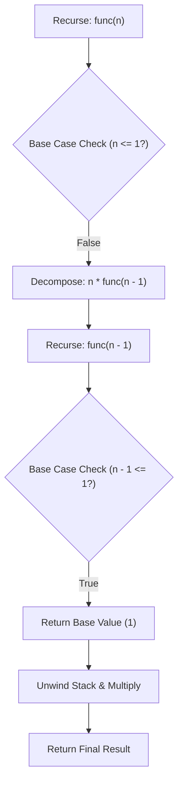

<p align="center">
  
</p>

<p align="center">
  
  
  
  
  
</p>

---

## Executive Summary / Overview
### Problem Statement & Context
Recursive formulations offer elegant, mathematically provable solutions to divide-and-conquer problems. However, an unverified base case or uncontrolled call depth easily results in stack overflows or exponential time explosion (O(2^n)). Rigorous analysis of recursive tree branching is vital for ensuring algorithmic correctness and space bounded execution.

### Solution Overview
This repository contains a dedicated academic suite analyzing **Recursive Problem Solving** in Python. Spanning two detailed notebooks (`Recursion(1).ipynb` and `Recursion.HW.ipynb`), the code demonstrates exact termination conditions, recursive state accumulation, subproblem reduction, and call-stack unwinding mechanics across a broad variety of numerical and sequence algorithms.

---

## Interactive Table of Contents
- [Executive Summary / Overview](#executive-summary--overview)
- [Key Features & Capabilities](#key-features--capabilities)
- [System Architecture / Pipeline](#system-architecture--pipeline)
- [Tech Stack Breakdown](#tech-stack-breakdown)
- [Reproducible Quickstart & Setup](#reproducible-quickstart--setup)
- [Project Directory Layout](#project-directory-layout)
- [Author & Contributions](#author--contributions)

---

## Key Features & Capabilities
- **Strict Base-Case Enforcement:** Clear boundary conditionals to prevent runaway recursion and call-stack exhaustion.
- **Divide-and-Conquer Formulations:** Practical decomposition of complex computations into self-similar sub-problems.
- **Call-Stack Visual Tracing:** Stepwise notebook cells mapping each activation record and returned accumulator value.
- **Recurrence Relation Analysis:** Explores recurrence relations and algorithmic reduction steps (e.g., T(n) = T(n-1) + O(1)).

---

## System Architecture / Pipeline


---

## Tech Stack Breakdown
| Layer | Technology | Purpose |
| :--- | :--- | :--- |
| **Languages** | Python 3.10+ | Algorithmic scripting and execution |
| **Libraries** | Python Standard Library | Recursion limit management and stack assertions |
| **Tools** | Jupyter Notebook | Interactive cell evaluation and test-case execution |
| **Architecture** | Divide-and-Conquer Recursion | Stack frame allocation and reduction mechanics |

---

## Reproducible Quickstart & Setup
```bash
# 1. Clone repository
git clone https://github.com/suryateja-155/DSA-assignment.git
cd DSA-assignment

# 2. Virtual environment setup
python -m venv venv
.\venv\Scripts\activate   # On Windows

# 3. Install Jupyter
pip install notebook

# 4. Launch recursion lab
jupyter notebook "Recursion(1).ipynb"
```

---

## Project Directory Layout
```text
DSA-assignment/
├── Recursion(1).ipynb     # Core recursive functions and state transitions (20 cells)
├── Recursion.HW.ipynb    # Extended recursion homework and algorithmic problems (13 cells)
└── README.md             # System documentation and recurrence relation guide
```

---

## Author & Contributions

**Gettupalli Surya Teja**  
- GitHub Profile: [@suryateja-155](https://github.com/suryateja-155)  
- Portfolio Index: [Gettupalli-Surya-Teja](https://github.com/suryateja-155/Gettupalli-Surya-Teja)

Contributions, issue reports, and feedback are always welcome! Feel free to open an issue or pull request.

<p align="center">
  
</p>
